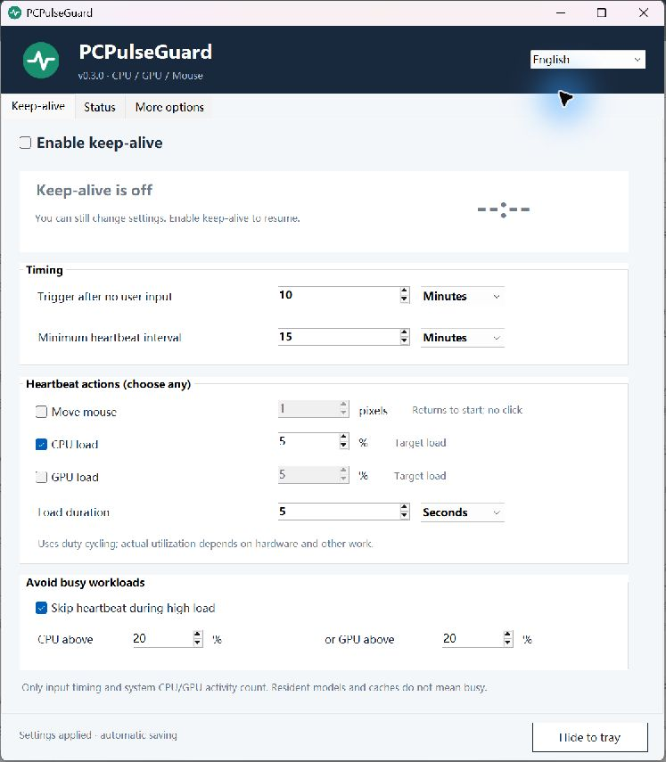
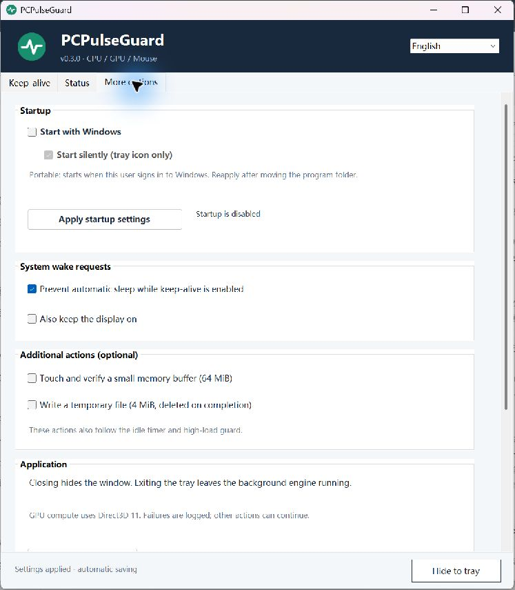

# PCPulseGuard

[English](README.md) · [简体中文](README.zh-CN.md)

A Windows tray utility that runs configurable heartbeats after you stop using the keyboard and mouse. Keep a workstation available between real workloads, with optional CPU/GPU activity and a high-load guard.

**[Download the latest release](https://github.com/MaIll-cc/PCPulseGuard/releases/latest)** · [Report an issue](https://github.com/MaIll-cc/PCPulseGuard/issues) · [MIT license](LICENSE)



## What it does

- Uses **time since user input** as the primary trigger. CPU/GPU load is a separate, optional guard.
- Lets you independently select mouse movement, a CPU load target and a GPU load target.
- Supports seconds, minutes and hours for every time setting.
- Skips heartbeats when CPU **or** GPU compute utilization exceeds your chosen threshold. Running heartbeats also stop when real input resumes or other computation becomes busy.
- Treats models and caches resident in RAM/VRAM as idle when they are not computing. It does not monitor named applications.
- Shows live CPU/GPU usage, idle duration, a countdown, recent results and a rotating log. Closing the window hides it to the tray.
- Offers optional sleep/display wake requests, a small memory-buffer check and a temporary disk write.
- Includes seven interface languages and a GitHub Releases update checker.
- Offers **Start with Windows** and a nested **Start silently (tray icon only)** option in More options.

> This tool is a workaround for idle behavior, not a hardware repair or a guarantee of uptime. Periodic pulses do not guarantee that CPU/GPU low-power states never occur. Investigate crashes, firmware and drivers separately.

## Requirements

Windows 10/11 **x64**, .NET Framework 4.7.2 or later, and an interactive Windows session for the tray and mouse action. GPU computation requires a hardware adapter supporting Direct3D 11 compute / feature level 11.0. CPU-only operation works without GPU support.

The GPU path has been tested on an NVIDIA RTX 3060, including the SYSTEM boot session. Other adapters still need field testing. Windows GPU Engine counters are the primary utilization source; NVIDIA NVML is an optional sensor fallback, not a bundled dependency.

## Quick start

1. Download `PCPulseGuard-<version>-windows-x64.zip` from Releases and extract it into a writable local directory.
2. Run **PCPulseGuard.exe**. No administrator rights are needed in portable mode.
3. Enable keep-alive, choose an inactivity delay and select the actions you want.
4. Optionally enable the high-load guard, then hide the window to the tray.

The executable is currently **unsigned**. Verify the release's SHA-256 checksums and obtain binaries from this repository's Releases. No background installation or executable download happens during update checks.

### Run at boot

Open PowerShell **as administrator** in the extracted directory and run:

```powershell
powershell -NoProfile -ExecutionPolicy Bypass -File .\Install.ps1
```

The default installation is `%ProgramData%\PCPulseGuard`. The installer creates a SYSTEM task at boot plus an input-monitor task and tray task at the selected user's logon. Tasks restart after failure. Program files are protected; only the input/preferences directory is writable by that user. Existing settings are preserved and replacements are backed up. No firmware, Windows automatic-login, firewall or remote-access settings are changed.

SYSTEM starts before login; the tray appears after login. Mouse movement requires an unlocked desktop. Installation does not enable automatic login. To install for a different account, explicitly supply its `-UserSid` and `-UserProfilePath`.



In **More options → Startup**, choose **Start with Windows** and, optionally, **Start silently (tray icon only)**, then select **Apply startup settings**. Silent startup defaults to on; turning it off opens the main window at sign-in. Portable mode registers this copy for the current user's sign-in without administrator rights. Keep its folder in place, or reapply after moving it. Turn startup off before deleting a portable copy.

Installed mode controls the three existing boot/logon tasks and requires Windows administrator approval to apply changes. Turning startup off affects future automatic launches; it does not stop the current heartbeat engine. Turn the keep-alive master switch off to stop heartbeats. Manually opening an installed copy while its engine is stopped requests administrator approval to start it, preserving the chosen startup setting.

To update an installed copy, extract the new release and rerun Install.ps1 with the same installation directory and task prefix. Custom installations require the original `-InstallRoot` and `-TaskPrefix` parameters. The installer preserves startup enabled/disabled and silent/windowed choices. Do not overwrite running executables by hand.

## Settings

| Setting | Fresh-install default | Meaning |
| --- | --- | --- |
| Enable keep-alive | On | Master switch; off also releases this app's wake request. |
| No-input delay | 10 minutes | Minimum time since user input before a heartbeat. |
| Minimum interval | 15 minutes | Measured from the previous completed heartbeat's end. Both timing conditions must be met. |
| Mouse movement | Off, 1 pixel | Adjustable 1–10,000 pixels, limited to available space on the current screen. Moves out and back without clicking. |
| CPU load | On, target 5% | Low-priority duty-cycled work. |
| GPU load | Off, target 5% | Direct3D 11 compute work. |
| Load duration | 5 seconds | CPU/GPU pulse duration; all time fields allow seconds/minutes/hours. |
| High-load guard | On, CPU 20% / GPU 20% | Skip if either measured compute load is above its threshold. |
| Prevent sleep | On | Active only while the master switch is on. Keeping the display on is separate and off by default. |
| Daily update check | On | Can be disabled in More options. Manual checks remain available. |

No-input delay and interval range from 1 second to 7 days. Load duration ranges from 1 second to 24 hours. Times round to whole seconds. Load targets and busy thresholds range from 1% to 100%; disable an action rather than setting it to zero. Migrated settings may differ from these fresh-install defaults.

CPU/GPU percentages are approximate targets, not precision utilization guarantees. Use the actual readings in Status. A pulse excludes its own process from the busy comparison when the relevant counters support it. GPU temperature at 85°C or above defers/stops GPU pulses when a temperature reading is available. Missing temperature data does **not** imply a safe temperature.

Mouse pulses do not reset this app's idle timer. Locked/secure desktops, held mouse buttons, missing input monitoring or system input restrictions can skip the mouse action. A partial result means some selected actions did not complete; consult the log.

## Languages

Use the language selector in the header. Switching is immediate and remembered: 简体中文, 繁體中文, English, 日本語, Deutsch, Español and Français. UI labels, status, tray menus, time units and update messages are translated. Technical diagnostic logs and operating-system error text may remain in English or the OS language. Translation improvements are welcome.

## Updates and privacy

Use **More options → Version and updates** or the tray's **Check for updates**. Checks query the latest stable release from this repository using HTTPS. New releases offer a button opening the official GitHub release page. There is no automatic download, execution, elevation or installation. Drafts and prereleases are excluded; network errors and API rate limits are shown separately.

The heartbeat engine works offline. Update checks send GitHub a normal HTTPS request with the app name/version as User-Agent, exposing the usual network metadata such as your IP address. Daily checks can be disabled. No input contents, application names, window titles, screenshots, model/service configuration, logs or machine identifiers are uploaded.

The local input bridge records timestamps and whether the desktop can accept a mouse pulse. It does **not** record typed keys or a mouse-position history. Settings, session timestamps, status and logs remain in the portable directory or chosen installation directory; a log rotates at about 2 MiB. **Exit tray** leaves the engine running. To stop heartbeats, turn the master switch off. This does not reverse an independent Windows power plan.

## Uninstall

From an elevated PowerShell, run `Uninstall.ps1` with the installation directory:

```powershell
powershell -NoProfile -ExecutionPolicy Bypass -File .\Uninstall.ps1
# Custom location:
powershell -NoProfile -ExecutionPolicy Bypass -File .\Uninstall.ps1 -InstallRoot "C:\ProgramData\MyWorkstation"
```

It removes the app's tasks, processes, program files and shortcuts. Settings, logs and backups are deliberately retained in the installation directory. Portable copies have no boot tasks unless you installed them; stop the app's processes before removing their folder.

## Build and validation

```powershell
.\Build.ps1                           # Windows/.NET Framework C# compiler, no NuGet packages
.\bin\PulseChecks.exe --gpu-check     # Optional real GPU compute and output verification
.\bin\PulseChecks.exe --startup-check # Optional temporary HKCU startup-entry roundtrip
.\IntegrationChecks.ps1               # Real input bridge, mouse, CPU/GPU and cancellation checks
.\Package.ps1                         # Portable/source ZIPs and SHA256SUMS.txt
```

The source targets C# 5 / .NET Framework and x64. CI builds and runs logic, localization and update-validation checks on Windows. GPU/integration checks need suitable hardware and an unlocked, temporarily unused desktop; they intentionally move the pointer out and back and briefly load hardware. CI does not claim to validate GPUs or long-term idle stability.

See [CONTRIBUTING.md](CONTRIBUTING.md), [SECURITY.md](SECURITY.md) and [CHANGELOG.md](CHANGELOG.md). The timing/action UX was inspired by [Amphetamine](https://apps.apple.com/us/app/amphetamine/id937984704) and low-priority load tools such as [CPUIdleStabilizer](https://github.com/cjdatadev/CPUIdleStabilizer). Neither application is bundled.
