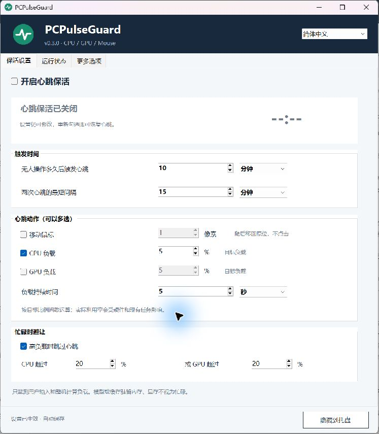
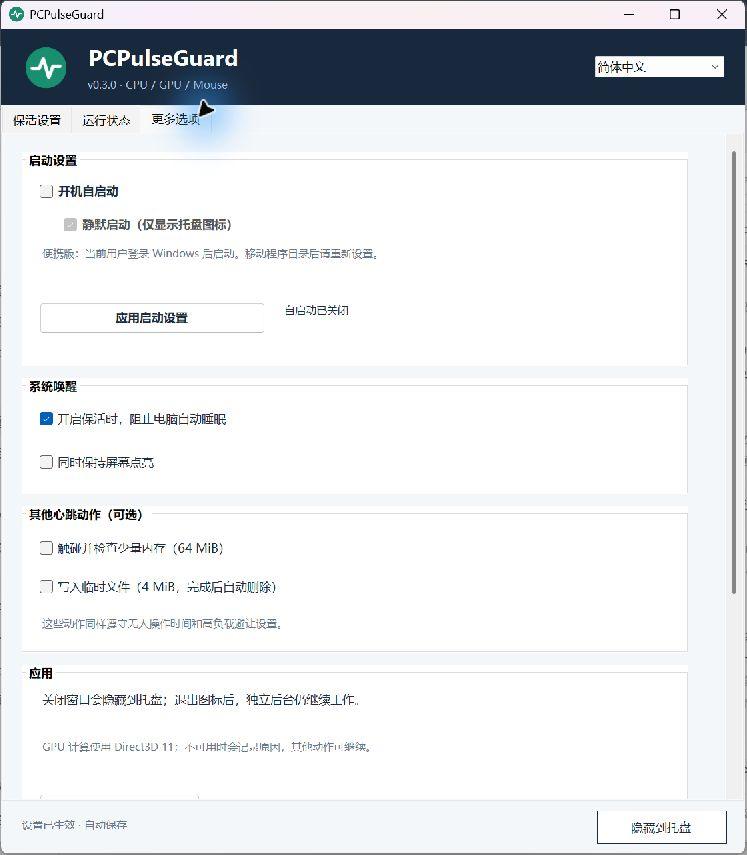

# PCPulseGuard

[English](README.md) · [简体中文](README.zh-CN.md)

一个 Windows 托盘保活工具：在用户停止键鼠操作一段时间后，执行可配置的鼠标、CPU 或 GPU 心跳，并在计算繁忙时主动避让。适合需要长期保留工作环境、后台服务或远程访问的工作站。

**[下载最新版本](https://github.com/MaIll-cc/PCPulseGuard/releases/latest)** · [反馈问题](https://github.com/MaIll-cc/PCPulseGuard/issues) · [MIT 开源许可](LICENSE)





在 **更多选项 → 启动设置** 中可设置“开机自启动”，下方的“静默启动”决定登录后只显示托盘图标，还是打开主窗口；修改后点击“应用启动设置”。静默启动默认开启。

便携版设置当前用户登录后启动，无需管理员权限；移动程序目录后需重新应用，删除便携版前请先关闭自启动。安装版控制已有的三个开机／登录任务，应用修改时需要 Windows 管理员授权。关闭自启动只影响后续自动启动，当前后台仍继续工作；如需停止心跳，请取消“开启心跳保活”。手动打开已安装的应用时，如果后台没有运行，会请求管理员授权启动后台，并保留原有自启动选择。升级安装会保留自启动开关和静默启动选择。

## 功能与判断逻辑

- 以**无人操作时长**为首要条件，再检查最短间隔和可选的计算负载阈值。
- 鼠标移动、CPU 负载、GPU 负载可独立选择，也可以组合使用。
- 所有时间设置都支持秒、分钟、小时。
- CPU **或** GPU 计算利用率超过用户设定值时跳过心跳；执行中恢复用户操作或出现其他高计算负载时也会结束心跳。
- 模型、缓存仅驻留在内存或显存中不会被判断为忙碌；无需针对 Strata 或其他特定应用配置。
- 托盘悬浮显示状态与倒计时，窗口提供整机 CPU/GPU 实际利用率、无人操作时长、最近结果和轮换日志。
- 可选防止自动睡眠、保持屏幕点亮、小内存缓冲区检查和临时文件写入。
- 支持七种界面语言，以及 GitHub Releases 版本更新检查。

> 本工具提供保活策略，不能修复硬件、固件或驱动故障，也不保证电脑永不崩溃。间歇心跳不能保证底层 CPU/GPU 节能状态永远不发生；长期无人操作的稳定性仍需实际观察。

## 系统要求

Windows 10/11 **x64**，.NET Framework 4.7.2 或更高版本。托盘和鼠标动作需要已登录的 Windows 会话。GPU 计算需要支持 Direct3D 11 Compute、功能级别 11.0 的硬件显卡；不支持 GPU 时仍可使用 CPU 等动作。

目前已在 NVIDIA RTX 3060 上验证 GPU 计算及 SYSTEM 开机会话；其他显卡仍需用户实际验证。GPU 利用率优先来自 Windows GPU Engine 性能计数器，NVIDIA NVML 仅作为可选的传感器补充，不随应用捆绑。

## 下载与便携使用

1. 从 Releases 下载 `PCPulseGuard-<版本>-windows-x64.zip`，解压至当前账户可写的本地目录。
2. 运行 **PCPulseGuard.exe**，便携模式无需管理员权限。
3. 勾选“开启心跳保活”，设置无人操作时长并选择动作。
4. 根据需要启用高负载避让，然后隐藏到托盘。

当前程序**尚未进行代码签名**。请从本仓库的 Releases 获取程序，并核对提供的 SHA-256 校验值。更新检查本身不会下载或安装程序。

## 安装为开机后台任务

在解压目录中，以**管理员身份**打开 PowerShell，执行：

```powershell
powershell -NoProfile -ExecutionPolicy Bypass -File .\Install.ps1
```

默认安装目录为 `%ProgramData%\PCPulseGuard`。安装器创建三个任务：SYSTEM 开机后台、指定账户登录时的输入监测、指定账户登录时的托盘界面。任务失败后会尝试重启。程序文件受保护，仅输入和偏好设置目录允许该账户修改；更新会保留设置并备份替换的文件。

后台可先于用户登录启动，托盘在登录后出现；鼠标动作需要解锁的桌面。本工具不会配置 Windows 自动登录，也不会改动 BIOS、内存频率、远程端口、防火墙或现有服务。为另一账户安装时需明确传入 `-UserSid` 和 `-UserProfilePath`。

更新已安装版本时，解压新版后重新运行安装脚本。自定义安装必须使用原先的 `-InstallRoot` 和 `-TaskPrefix`，避免产生两套后台任务；不要直接覆盖正在运行的程序。

## 设置说明

| 设置 | 全新安装默认值 | 作用 |
| --- | --- | --- |
| 开启心跳保活 | 开启 | 总开关；关闭时也释放本应用的系统唤醒请求。 |
| 无人操作时长 | 10 分钟 | 用户输入停止多久后才允许心跳。 |
| 两次心跳最短间隔 | 15 分钟 | 从上次完成的心跳结束后计算；两个计时条件都需满足。 |
| 移动鼠标 | 不勾选，1 像素 | 可输入 1–10000 像素，受当前屏幕可移动空间限制；移动后立即返回，不点击。 |
| CPU 负载 | 勾选，目标 5% | 低优先级间歇计算。 |
| GPU 负载 | 不勾选，目标 5% | Direct3D 11 计算。 |
| 负载持续时间 | 5 秒 | CPU/GPU 负载持续多久；全部时间字段均可选择秒、分钟、小时。 |
| 高负载避让 | 开启，CPU/GPU 各 20% | 任一计算利用率高于阈值时避让。 |
| 防止自动睡眠 | 开启 | 仅在总开关开启时生效；保持屏幕点亮另设开关，默认关闭。 |
| 每日检查更新 | 开启 | 可在“更多选项”关闭，仍可手动检查。 |

无人操作时长、最短间隔允许 1 秒至 7 天，持续时间允许 1 秒至 24 小时，后台按整秒执行。负载目标和忙碌阈值范围为 1%–100%；不需要动作时取消勾选。旧版本迁移后的设置可能与上述默认值不同。

目标利用率是近似值，实际比例受硬件、调度和其他任务影响，请查看“运行状态”中的实际利用率。性能计数器支持时，运行中的心跳会从忙碌判断中排除自身进程。显卡温度读数达到 85°C 时会暂缓或结束 GPU 心跳；**没有温度读数不代表温度安全**。

本应用自己的鼠标动作不会重置无人操作计时。锁屏、安全桌面、鼠标按键按住、输入监测不可用或系统阻止输入时，鼠标动作可能跳过。“部分完成”表示某些选中动作没有完成，应查看日志。

## 语言切换

窗口右上角可切换简体中文、繁体中文、英文、日文、德文、西班牙文、法文，立即生效并保存选择。主界面、状态、托盘菜单、时间单位及更新提示均有翻译；技术日志和操作系统错误信息可能仍使用英文或系统语言。欢迎提交翻译改进。

## 检查更新与隐私

在“更多选项 → 版本与更新”或托盘右键菜单中选择“检查版本更新”。应用通过 HTTPS 查询本仓库最新的公开稳定版，发现新版后提供官方 GitHub Release 页面入口，**不会自动下载、执行、提权或安装**。草稿版和预发布版不参与更新；网络失败与 GitHub 请求限额会单独提示。

心跳后台本身离线工作。版本检查会向 GitHub 发出普通 HTTPS 请求，User-Agent 包含应用名称与版本，GitHub 可获得 IP 地址等常规网络元数据；可关闭每日自动检查。不会上传输入内容、应用名称、窗口标题、截图、模型或服务配置、日志、机器标识。

本地输入监测仅记录活动时间及桌面能否接收鼠标动作，不记录按键内容或鼠标位置历史。设置、会话时间、状态和日志保存在便携目录或指定安装目录，日志约 2 MiB 后轮换。

关闭窗口只是隐藏；“退出图标（后台继续）”不会关闭后台。如需停止心跳，应取消“开启心跳保活”。这不会撤销独立配置的 Windows 电源计划。

## 卸载

以管理员身份执行：

```powershell
powershell -NoProfile -ExecutionPolicy Bypass -File .\Uninstall.ps1
# 自定义安装位置：
powershell -NoProfile -ExecutionPolicy Bypass -File .\Uninstall.ps1 -InstallRoot "C:\ProgramData\MyWorkstation"
```

卸载会移除本应用任务、进程、程序文件和快捷方式，**保留设置、日志与备份**。便携版若未运行安装脚本则没有开机任务；移除目录前应先结束对应进程。

## 从源码构建与验证

```powershell
.\Build.ps1                           # Windows 自带的 .NET Framework C# 编译器，无 NuGet 依赖
.\bin\PulseChecks.exe --gpu-check     # 可选：实际 GPU 计算及结果核验
.\IntegrationChecks.ps1               # 实测输入监测、鼠标、CPU/GPU 与停止行为
.\Package.ps1                         # 生成便携包、源码包和 SHA256SUMS.txt
```

源码使用 C# 5 / .NET Framework，目标 x64。Windows CI 检查编译、逻辑、翻译和更新数据校验；GPU 与完整集成检查需要合适硬件和暂时无人操作的已解锁桌面，会短暂移动鼠标并产生硬件负载。CI 通过不等于验证了所有显卡或长期稳定性。

参见 [贡献说明](CONTRIBUTING.md)、[安全说明](SECURITY.md) 和 [更新日志](CHANGELOG.md)。交互概念参考了 [Amphetamine](https://apps.apple.com/us/app/amphetamine/id937984704) 和 [CPUIdleStabilizer](https://github.com/cjdatadev/CPUIdleStabilizer) 等低优先级负载工具；本项目不捆绑这些应用。
